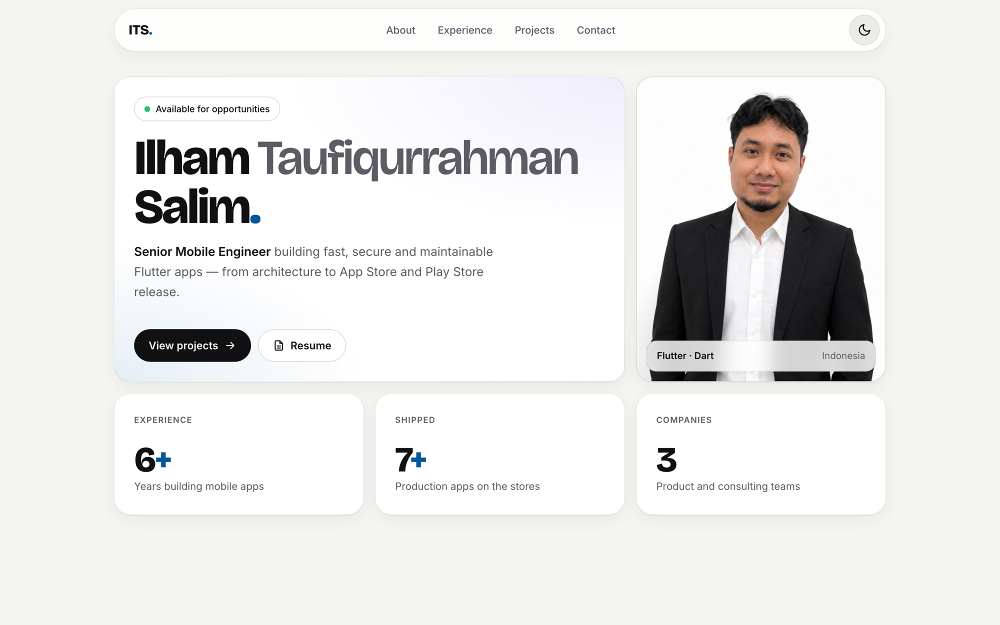

# Personal Portfolio ⚡️

> Portfolio of Ilham Taufiqurrahman Salim — Senior Mobile Engineer (Flutter).

> https://ilhamte.github.io/my-portfolio

### Website Preview

<p align="center">
  <kbd>
    <a href="https://ilhamte.github.io/my-portfolio" target="_blank"></a>
  </kbd>
</p>

## Features 📋

- Bento grid layout, fully responsive (desktop, tablet, phone)
- Light and dark theme — follows the system setting, with a manual toggle that is remembered
- Screenshot gallery per project with a full-size preview
- Accessible: skip link, keyboard focus styles, screen reader labels, `prefers-reduced-motion` support
- SEO ready: meta description, Open Graph / social preview image, JSON-LD, sitemap
- Plain HTML, CSS and JavaScript — no framework, no build step

## Project Structure 🗂️

```
index.html                  All page content
assets/css/style.css        Styles and theme tokens (light + dark)
assets/js/main.js           Theme toggle, mobile menu, scroll reveal, lightbox
assets/images/
  meh.png                   Profile photo (source)
  meh-web.jpg               Profile photo used by the site (cropped, max 1000px)
  og-image.png              Social preview (1200×630)
  favicon.svg
  projects/<app>/           Original screenshots (source files)
  shots/<app>/              Resized screenshots used by the site
robots.txt, sitemap.xml
```

## Editing Content ✏️

- **Text, experience, projects:** edit `index.html`.
- **Colors and fonts:** edit the tokens at the top of `assets/css/style.css` (`:root` for light, `:root[data-theme="dark"]` for dark).
- **Adding a screenshot:** put the original in `assets/images/projects/<app>/`, then make a web copy (max 1000px, JPEG):

  ```sh
  sips -s format jpeg -s formatOptions 78 -Z 1000 \
    assets/images/projects/<app>/image_1.png \
    --out assets/images/shots/<app>/image_1.jpg
  ```

  Add an `<a class="shot">` in that project's `.shots` block in `index.html`.

## Run Locally 💻

Open `index.html` in a browser, or serve the folder:

```sh
python3 -m http.server 8000
```

## Deployment 📦

Hosted on [GitHub Pages](https://pages.github.com/). Push to the `main` branch and GitHub Pages publishes the site.

## Sections 📚

✔️ About\
✔️ Skills\
✔️ Experience\
✔️ Projects\
✔️ Education\
✔️ Contact & Resume

## License 📄

This project is licensed under the MIT License.
